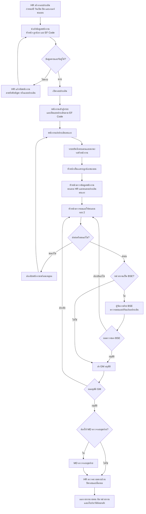

# โฟลระบบ E-Performance

ปรับจากภาพโฟลเดิมที่ผู้ใช้ส่งมาเมื่อ 5 พฤศจิกายน 2569 โดยเพิ่มขั้นของฝ่าย BSE หลังหัวหน้างานให้คะแนนรอบ 2

## จุดที่เปลี่ยนจากโฟลเดิม

| เดิม | ปรับใหม่ |
|---|---|
| หัวหน้าส่งผลต่อไป GM | ตรวจหน่วยงานก่อน: **BSE** ผ่านผู้จัดการฝ่าย BSE; หน่วยงานอื่นส่ง GM ได้เลย |
| ขั้น BSE ยังไม่ระบุการทำงาน | ผู้จัดการฝ่าย BSE ตรวจสอบ ปรับแก้ ส่งกลับหัวหน้า หรืออนุมัติเพื่อส่ง GM |
| หัวหน้าตรวจผลตนเองและให้คะแนนรอบ 2 | เพิ่มหน้าตรวจทานที่เห็นข้อมูลพนักงาน คะแนน HR และคะแนนประเมินตนเองพร้อมกัน |

หน้าตรวจทานรายคนมีในโค้ดแล้ว ส่วนสถานะส่งประเมิน การให้คะแนนในเว็บ ขั้น BSE/GM/MD และการปิดรอบยังเป็นงานที่ต้องพัฒนา การส่งกลับจาก BSE ในโฟลนี้ไปยังหัวหน้างานรอบ 2; ถ้าต้องส่งกลับถึงพนักงาน หัวหน้าจะใช้ทางส่งกลับเดิม
